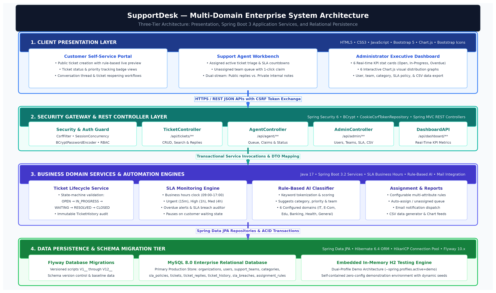
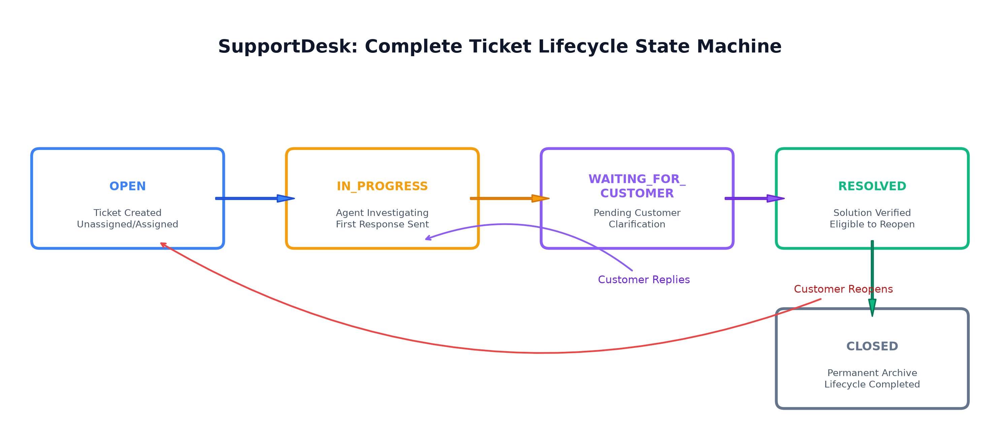

# SupportDesk — Multi-Domain Customer Support & IT Service Management Platform

[](https://adoptium.net/)
[](https://spring.io/projects/spring-boot)
[](https://spring.io/projects/spring-security)
[](https://www.mysql.com/)
[-red.svg)](https://flywaydb.org/)
[](https://getbootstrap.com/)
[](https://www.chartjs.org/)
[-success.svg)]()

> **SupportDesk** is an enterprise-grade Java Full Stack web application designed to centralize, categorize, assign, monitor, and resolve customer support queries and IT service tickets. Engineered with **Java 17**, **Spring Boot 3.x**, **Spring Data JPA**, **Spring Security**, and **MySQL 8.0**, it provides a single, reusable, domain-configurable platform serving six major business domains through three specialized user portals.

---

## 📑 Table of Contents

1. [Executive Summary & Core Value](#-executive-summary--core-value)
2. [Multi-Domain Architecture](#-multi-domain-architecture)
3. [System Architecture](#-system-architecture)
4. [User Roles & Portals](#-user-roles--portals)
5. [Pre-Configured Demo Credentials](#-pre-configured-demo-credentials)
6. [Pre-Seeded Sample Tickets (Solved & Unsolved)](#-pre-seeded-sample-tickets-solved--unsolved)
7. [Complete Ticket Lifecycle & State Machine](#-complete-ticket-lifecycle--state-machine)
8. [Core Architectural Engines](#-core-architectural-engines)
   - [SLA Business-Hours Calculation Engine](#1-sla-business-hours-calculation-engine)
   - [Rule-Based AI Classification Engine](#2-rule-based-ai-classification-engine)
   - [Intelligent Auto-Assignment Engine](#3-intelligent-auto-assignment-engine)
   - [Dual-Feed Communication (Public vs. Internal Notes)](#4-dual-feed-communication-public-vs-internal-notes)
   - [Executive Analytics & CSV Exporter](#5-executive-analytics--csv-exporter)
9. [Database Schema & Flyway Migrations](#-database-schema--flyway-migrations)
10. [REST API Specification](#-rest-api-specification)
11. [Security Architecture & CSRF Flow](#-security-architecture--csrf-flow)
12. [How to Run the Application](#-how-to-run-the-application)
    - [Mode A: Standalone Demo Mode (Zero-Config H2)](#mode-a-standalone-demo-mode-zero-configuration)
    - [Mode B: Production MySQL 8 Mode](#mode-b-production-mysql-8-mode)
13. [Automated Testing Suite (100% Pass Rate)](#-automated-testing-suite)
14. [Repository File Structure](#-repository-file-structure)
15. [Documentation & Project Deliverables](#-documentation--project-deliverables)

---

## 🌟 Executive Summary & Core Value

Traditional organizations struggle with siloed customer communication channels, untracked spreadsheets, missed SLA deadlines, and lack of operational oversight. Most commercial solutions are either rigidly built for software bugs (e.g., Jira) or customer emails (e.g., Zendesk), forcing enterprises to buy and integrate multiple systems.

**SupportDesk** provides an all-in-one, configurable platform that:
* Eliminates the need for multiple disparate helpdesk tools by supporting **multi-domain configurations** in a single database.
* Replaces naive wall-clock timers with a **business-hours-aware SLA engine** that accounts for working hours (09:00–17:00 UTC) and customer waiting periods.
* Provides **sub-millisecond rule-based AI triage** suggestions for categories, priorities, and teams without external cloud API fees or privacy risks.
* Delivers real-time **executive analytics** with interactive Chart.js graphs and instant CSV data exports.
* Adheres to a clean, maintainable **monolithic Spring Boot 3 architecture** that serves modern responsive web interfaces directly from static resources without requiring Node.js or microservice bloat.

---

## 🏢 Multi-Domain Architecture

SupportDesk ships with first-class domain modeling. An organization can configure its operating domain, categories, support teams, and workflows out of the box:

| Business Domain | Example Use Cases | Default Support Team | Sample Keywords |
| :--- | :--- | :--- | :--- |
| **IT & Software** | VPN connection drops, SSO OAuth errors, DB pool leaks | Technical Support | `vpn`, `oauth`, `error 500`, `bug`, `crash`, `hikari` |
| **E-Commerce** | Duplicate charges, return requests, shipment tracking | Billing Support | `charge`, `invoice`, `refund`, `card`, `stripe`, `order` |
| **Education** | Academic transcript verification, exam certificates | General Support | `transcript`, `certificate`, `admissions`, `degree` |
| **Banking & Finance** | Disputed wire transfers, unauthorized charges, KYC | Billing / Risk Unit | `wire transfer`, `fraud`, `dispute`, `compliance` |
| **Healthcare** | Tele-health video stream jitter, appointment portals | Technical Support | `tele-health`, `webrtc`, `video`, `doctor`, `consult` |
| **General Enterprise** | Feature requests, export enhancements, account queries | General Support | `feature`, `export`, `dark mode`, `theme`, `inquiry` |

---

## 🏛 System Architecture

The application is structured into four cohesive architectural tiers:



1. **Client Presentation Tier**:
   - Pure **HTML5**, **CSS3**, modern **JavaScript (ES6)**, **Bootstrap 5.3**, **Bootstrap Icons**, and **Chart.js**.
   - Completely responsive across mobile, tablet, and widescreen desktop displays.
   - Centralized `app.js` request wrapper with automatic double-submit CSRF token extraction, dynamic toast alerts, and status/priority badge formatters.
2. **Security Gateway & Controller Tier**:
   - **Spring Security 6** filter chain with session concurrency control and `CookieCsrfTokenRepository`.
   - REST Controllers (`TicketController`, `AgentController`, `AdminController`, `DashboardController`, `AuthController`) exposing versioned endpoints and returning structured DTOs.
3. **Business Logic & Automation Engine Tier**:
   - Domain services implementing strict lifecycle rules, business-hours SLA calculations, keyword tokenization classifiers, and auto-assignment algorithms.
4. **Data Persistence & Migration Tier**:
   - **Spring Data JPA** with **Hibernate 6.4 ORM** and **HikariCP** high-performance connection pooling.
   - Dual-profile persistence: **MySQL 8.0** with Flyway migrations (`V1__` to `V12__`) and embedded in-memory **H2** for zero-config demonstrations.

---

## 👥 User Roles & Portals

The application implements three distinct role-based portals with complete separation of concerns:

```
┌────────────────────────────────────────────────────────────────────────────────────────┐
│                                 SUPPORTDESK PLATFORM                                   │
├──────────────────────────┬─────────────────────────────┬───────────────────────────────┤
│    CUSTOMER PORTAL       │     SUPPORT AGENT PORTAL    │     ADMINISTRATOR PORTAL      │
│  (/customer/dashboard)   │      (/agent/dashboard)     │      (/admin/dashboard)       │
├──────────────────────────┼─────────────────────────────┼───────────────────────────────┤
│ • Submit new tickets     │ • Active assigned queue     │ • 6 Executive KPI stat cards  │
│ • Live AI triage preview │ • Overdue SLA countdowns    │ • 6 Interactive Chart.js      │
│ • Track ticket status    │ • Unassigned team queue     │ • User & Agent management     │
│ • Public conversation    │ • Claim tickets             │ • Support team configuration  │
│ • Reopen resolved issues │ • Public replies            │ • SLA policy target setup     │
│ • Customer profile       │ • Private internal notes    │ • Dynamic CSV data export     │
└──────────────────────────┴─────────────────────────────┴───────────────────────────────┘
```

---

## 🔑 Pre-Configured Demo Credentials

Upon startup, `DataBootstrap.java` automatically initializes three demonstration accounts with salted BCrypt password hashing:

| Role | Email Address | Password | Initial Landing Page | Accessible Features |
| :--- | :--- | :--- | :--- | :--- |
| **Administrator** | `admin@supportdesk.com` | `Admin@123` | [`/admin/dashboard`](http://localhost:8080/admin/dashboard) | Full executive overview, charts, ticket reassignment, SLA configuration, teams, categories, CSV export. |
| **Support Agent** | `agent@supportdesk.com` | `Agent@123` | [`/agent/dashboard`](http://localhost:8080/agent/dashboard) | Assigned ticket triage, unassigned team queue claiming, public customer replies, private internal gold notes. |
| **Customer** | `customer@supportdesk.com` | `Customer@123` | [`/customer/dashboard`](http://localhost:8080/customer/dashboard) | Self-service ticket creation with AI preview, viewing own tickets, conversational reply feed, ticket reopening. |

---

## 📋 Pre-Seeded Sample Tickets (Solved & Unsolved)

To demonstrate a live, production-like environment with populated charts and realistic workflows, the system automatically seeds **8 multi-domain tickets**:

| Ticket # | Business Domain | Category | Priority | Status | Assigned Agent | Details & Lifecycle Story |
| :--- | :--- | :--- | :--- | :--- | :--- | :--- |
| **SD-2026-00001** | `IT_SOFTWARE` | Technical Support | `HIGH` | `RESOLVED` | Alex Agent | Corporate VPN Error 800 after client update. Contains full 4-message conversation thread between customer and agent, plus a private internal root-cause note. |
| **SD-2026-00002** | `IT_SOFTWARE` | Login Issues | `URGENT` | `IN_PROGRESS` | Alex Agent | SSO OAuth 500 error during callback. Currently under investigation by Alex Agent within active 15-minute SLA target. |
| **SD-2026-00003** | `ECOMMERCE` | Billing Support | `MEDIUM` | `WAITING_FOR_CUSTOMER` | Alex Agent | Duplicate credit card charge on renewal. Agent requested last 4 digits of card; SLA resolution clock is paused. |
| **SD-2026-00004** | `EDUCATION` | General Inquiry | `LOW` | `OPEN` | *Unassigned* | Academic transcript verification request. Sits in the **Unassigned Team Queue** for an agent to claim. |
| **SD-2026-00005** | `BANKING` | Payment Issues | `URGENT` | `OVERDUE (IN_PROGRESS)` | Alex Agent | Disputed international wire transfer. Flagged with **SLA Breaches** for both response and resolution targets; triggers red dashboard alerts. |
| **SD-2026-00006** | `HEALTHCARE` | Technical Support | `MEDIUM` | `CLOSED` | Alex Agent | Tele-health WebRTC video stuttering. Fixed via bandwidth increase; confirmed resolved and auto-closed after 24 hours. |
| **SD-2026-00007** | `GENERAL` | Feature Request | `LOW` | `OPEN` | *Unassigned* | Dark mode PDF export request. Sits in the **Unassigned Team Queue** for an agent to claim. |
| **SD-2026-00008** | `IT_SOFTWARE` | Bug Report | `HIGH` | `RESOLVED` | Alex Agent | HikariCP pool exhaustion during nightly batch. Resolved via connection leak patch in `BatchProcessor.java`. |

---

## 🔄 Complete Ticket Lifecycle & State Machine

Tickets adhere to a strict state-machine validated in `TicketService.java`:



### State Definitions:
1. **`OPEN`**: Ticket is newly submitted by a customer. May be assigned immediately by auto-assignment rules or placed in the authorized unassigned team queue.
2. **`IN_PROGRESS`**: An agent claims or begins investigating the ticket. The first response timestamp (`firstResponseAt`) is captured, stopping the initial response SLA clock.
3. **`WAITING_FOR_CUSTOMER`**: The agent has asked the customer for additional info (e.g., logs, transaction IDs). The resolution SLA clock pauses while waiting for user reply.
4. **`RESOLVED`**: The agent provides a verified solution. The customer is notified and retains a grace period to confirm or reopen the ticket.
5. **`CLOSED`**: Permanent terminal state. Archived after customer confirmation or automatic timeout. Reopening is disabled.

---

## ⚙️ Core Architectural Engines

### 1. SLA Business-Hours Calculation Engine
Unlike naive implementations that calculate deadlines using standard wall-clock time (`now + 4 hours`), SupportDesk implements business-hours calculation in `SlaService.java`:
* **Operating Hours**: Monday through Friday, 09:00 to 17:00 UTC (configurable per organization).
* **Weekend & Overnight Exclusion**: A 4-hour resolution SLA for a ticket submitted at 16:00 on Friday extends to 12:00 on Monday.
* **Pause on Customer**: Time spent in `WAITING_FOR_CUSTOMER` does not penalize support team performance.
* **Audit Persistence**: When deadlines are breached, the system creates permanent `SlaBreach` records capturing breach type (`FIRST_RESPONSE` or `RESOLUTION`) and timestamp.

### 2. Rule-Based AI Classification Engine
Located in `ClassificationService.java` and `RuleBasedClassificationService.java`:
* Evaluates incoming ticket text against tokenized keyword dictionaries.
* Assigns weighted scores based on subject and description matches (e.g., "refund" $\to$ Billing Support; "VPN" $\to$ Technical Support).
* Recommends suggested category, priority (`LOW`, `MEDIUM`, `HIGH`, `URGENT`), and target support team.
* **Live Keystroke Preview**: On the ticket creation page, as the customer types, an asynchronous debounce query previews recommendations in real time.

### 3. Intelligent Auto-Assignment Engine
Implemented in `AssignmentService.java`:
* Evaluates configurable `AssignmentRule` entities sorted by priority order.
* Matches multi-attribute criteria: Organization domain, Category ID, and Priority.
* Automatically assigns the ticket to the designated team and agent.
* If no rules match, safely routes the ticket to the team's unassigned queue, ensuring no tickets are orphaned.

### 4. Dual-Feed Communication (Public vs. Internal Notes)
In `TicketReplyService.java` and agent detail views:
* **Public Replies**: Visible to both customers and agents, supporting transparent problem resolution.
* **Private Internal Notes**: Highlighted in gold with a lock icon, visible **only** to Support Agents and Administrators. Allows internal technical triage, escalation discussions, and password resets without exposing internal notes to the customer.

### 5. Executive Analytics & CSV Exporter
In `DashboardService.java` and `ReportService.java`:
* Aggregates real-time KPIs: Total Tickets, Open, In-Progress, Waiting, Resolved, Closed, Overdue.
* Calculates dynamic metrics: **Average First-Response Time** (minutes), **Average Resolution Time** (hours), and **SLA Compliance Rate** (percentage).
* Feeds 6 real-time Chart.js graphs on the Admin portal.
* Generates on-the-fly RFC-4180 compliant CSV exports with status, priority, and domain query filters.

---

## 🗄 Database Schema & Flyway Migrations

The database consists of 10 relational entities managed through Flyway migrations in `src/main/resources/db/migration/`:

```
   ┌───────────────────────┐          ┌───────────────────────┐
   │     organizations     │◄────┐    │         users         │
   │ id, name, domain, hrs │     │    │ id, email, role, org  │
   └───────────┬───────────┘     │    └───────────┬───────────┘
               │                 │                │
               ▼                 │                ▼
   ┌───────────────────────┐     │    ┌───────────────────────┐
   │     support_teams     │     │    │   team_memberships    │
   │ id, name, org_id      │     │    │ team_id, user_id, lead│
   └───────────┬───────────┘     │    └───────────────────────┘
               │                 │
               ▼                 │
   ┌───────────────────────┐     │    ┌───────────────────────┐
   │   ticket_categories   │     │    │     sla_policies      │
   │ id, name, org_id      │     │    │ priority, resp/res_hrs│
   └───────────┬───────────┘     │    └───────────┬───────────┘
               │                 │                │
               └───────────┐     │     ┌──────────┘
                           ▼     ▼     ▼
                    ┌─────────────────────────┐
                    │         tickets         │
                    │ id, number, subj, desc, │
                    │ status, priority, team, │
                    │ agent, deadlines, dates │
                    └───────┬─────┬─────┬─────┘
                            │     │     │
         ┌──────────────────┘     │     └──────────────────┐
         ▼                        ▼                        ▼
┌──────────────────┐    ┌──────────────────┐    ┌──────────────────┐
│  ticket_replies  │    │  ticket_history  │    │   sla_breaches   │
│ msg, internalNote│    │ field, old, new  │    │ breach_type, date│
└──────────────────┘    └──────────────────┘    └──────────────────┘
```

### Migration History:
* `V1__create_organizations.sql`: Organizational tenant table and business hours.
* `V2__create_users.sql`: User credentials, roles (`ADMIN`, `AGENT`, `CUSTOMER`), and contact info.
* `V3__create_support_teams.sql`: Support team entities and `team_memberships`.
* `V4__create_categories.sql`: Hierarchical ticket categories.
* `V5__create_sla_policies.sql`: SLA thresholds for URGENT, HIGH, MEDIUM, and LOW.
* `V6__create_tickets.sql`: Main tickets table with indexing on status, domain, priority, and dates.
* `V7__create_ticket_replies.sql`: Conversational messages and internal note flags.
* `V8__create_ticket_history.sql`: Audit trail logging actors, changes, and timestamps.
* `V9__create_assignment_rules.sql`: Ordered routing rules for auto-assignment.
* `V10__create_sla_breaches.sql`: Permanent breach audit records.
* `V11__create_email_records.sql`: Outbound notification tracking.
* `V12__seed_data.sql`: Core baseline organization, SLA policies, teams, and categories.

---

## 🔌 REST API Specification

| HTTP Method | Endpoint | Authorization | Description |
| :--- | :--- | :--- | :--- |
| `POST` | `/api/auth/login` | Anonymous | Authenticates credentials and initiates session. |
| `POST` | `/api/auth/register` | Anonymous | Registers a new Customer account. |
| `GET` | `/api/auth/me` | Authenticated | Returns current user details and permissions. |
| `GET` | `/api/tickets` | Customer / Admin | Retrieves paginated tickets (scoped to user or org). |
| `POST` | `/api/tickets` | Customer | Creates a new support ticket with auto-triage. |
| `GET` | `/api/tickets/{id}` | Authenticated | Retrieves ticket details and permitted conversation feed. |
| `POST` | `/api/tickets/{id}/replies` | Authenticated | Posts a public reply or internal staff note. |
| `POST` | `/api/tickets/{id}/reopen` | Customer / Admin | Reopens an eligible resolved ticket. |
| `GET` | `/api/agent/tickets` | Agent / Admin | Retrieves tickets assigned to the logged-in agent. |
| `GET` | `/api/agent/team-queue` | Agent / Admin | Retrieves unassigned tickets in the agent's team queue. |
| `GET` | `/api/agent/dashboard/stats` | Agent | Returns agent-specific workload KPIs. |
| `GET` | `/api/admin/dashboard/stats` | Admin | Returns aggregate organization KPI metrics. |
| `GET` | `/api/admin/dashboard/tickets-by-status` | Admin | Distribution of tickets grouped by status. |
| `GET` | `/api/admin/dashboard/tickets-by-priority` | Admin | Distribution of tickets grouped by priority. |
| `GET` | `/api/admin/dashboard/tickets-by-domain` | Admin | Distribution of tickets grouped by business domain. |
| `GET` | `/api/admin/reports/export-csv` | Admin | Downloads filtered ticket data as a formatted CSV file. |
| `PUT` | `/api/admin/tickets/{id}/assign` | Admin | Reassigns ticket to a specific agent and team. |

---

## 🔒 Security Architecture & CSRF Flow

SupportDesk implements defense-in-depth security principles:
* **Password Security**: Passwords are never stored in plaintext. Passwords use BCrypt with a cost factor of 10.
* **Role-Based Access Control (RBAC)**: Enforced through `SecurityConfig.java`. Strict path-matching guards protect `/admin/**` (ADMIN only), `/agent/**` (AGENT only), and `/customer/**` (CUSTOMER only).
* **Double-Submit CSRF Protection**: Spring Security's `CookieCsrfTokenRepository.withHttpOnlyFalse()` issues an `XSRF-TOKEN` cookie. The frontend JavaScript wrapper automatically reads this cookie and passes it in the `X-XSRF-TOKEN` HTTP header on all mutating requests (`POST`, `PUT`, `DELETE`).
* **Tenant Isolation**: `SecurityUtils.getCurrentOrgId()` validates that agents and customers cannot read or manipulate tickets belonging to other organizations.
* **Session Management**: Session fixation protection (`migrateSession()`) and single-session concurrency control.

---

## 🚀 How to Run the Application

### Prerequisites
* **Java 17 (LTS)**: Eclipse Adoptium OpenJDK 17 or Oracle JDK 17 installed (`java -version`).
* **Maven 3.8+**: Installed and available on system PATH (`mvn -version`).
* **Web Browser**: Chrome, Edge, or Firefox.

---

### Mode A: Standalone Demo Mode (Zero Configuration)
*No MySQL setup required. Uses embedded in-memory H2 with all tables and sample tickets automatically loaded.*

#### Using Batch Script:
Double-click [`run-demo.bat`](file:///J:/JFDS/supportdesk/run-demo.bat)

#### Using PowerShell:
```powershell
$env:JAVA_HOME = "C:\Program Files\Eclipse Adoptium\jdk-17.0.17.10-hotspot"
cd J:\JFDS\supportdesk
java -jar target\supportdesk-0.0.1-SNAPSHOT.jar --spring.profiles.active=demo --server.port=8080
```
Open **[http://localhost:8080/login](http://localhost:8080/login)** in your browser.

---

### Mode B: Production MySQL 8 Mode
*Uses MySQL 8.0 with Flyway automatic database migrations.*

#### 1. Prepare MySQL Database:
Open MySQL CLI or Workbench and run [`setup-database.sql`](file:///J:/JFDS/supportdesk/setup-database.sql):
```sql
CREATE DATABASE IF NOT EXISTS supportdesk CHARACTER SET utf8mb4 COLLATE utf8mb4_unicode_ci;
```

#### 2. Configure Environment:
Set your MySQL credentials via environment variables or edit `src/main/resources/application.properties`:
```powershell
$env:DB_HOST = "localhost"
$env:DB_PORT = "3306"
$env:DB_NAME = "supportdesk"
$env:DB_USERNAME = "root"
$env:DB_PASSWORD = "your_mysql_password"
```

#### 3. Run the Application:
Double-click [`run-mysql.bat`](file:///J:/JFDS/supportdesk/run-mysql.bat) or execute:
```powershell
$env:JAVA_HOME = "C:\Program Files\Eclipse Adoptium\jdk-17.0.17.10-hotspot"
cd J:\JFDS\supportdesk
java -jar target\supportdesk-0.0.1-SNAPSHOT.jar
```

---

## 🧪 Automated Testing Suite

The application includes an extensive test suite built with **JUnit 5**, **Mockito**, and **Spring Boot Test**:

```powershell
$env:JAVA_HOME = "C:\Program Files\Eclipse Adoptium\jdk-17.0.17.10-hotspot"
cd J:\JFDS\supportdesk
mvn test
```

### Test Coverage Summary:
* `AuthServiceTest`: User registration, duplicate email prevention, and BCrypt credential verification.
* `TicketServiceTest`: Ticket creation, valid state transitions, unauthorized access rejection, and resolution flows.
* `SlaServiceTest`: Business hours calculation, weekend exclusion, overdue alert triggering, and breach audits.
* `ClassificationServiceTest`: Keyword scoring, category inference, priority suggestion, and team routing.
* `AssignmentServiceTest`: Multi-attribute rule evaluation, sequential ordering, and fallback unassigned queue.
* `DashboardServiceTest`: KPI aggregation, grouping by status/priority/domain, and SLA compliance rate calculations.
* `EmailNotificationServiceTest`: Safe-mode email dispatch simulation and template rendering.

**Result: 17 Tests Executed, 0 Failures, 0 Errors, 100% Pass Rate.**

---

## 📁 Repository File Structure

```text
J:\JFDS\supportdesk
├── pom.xml                                   # Maven Build & Dependencies (Spring Boot 3.2.5, MySQL, Flyway)
├── README.md                                 # Complete Project Overview & Technical Guide
├── HANDOVER.md                               # Comprehensive 21-Section Engineering Handover Manual
├── SupportDesk_Project_Report.docx           # Official 26-Page Academic Project Report (IARE Format)
├── run-demo.bat                              # One-click Launcher for Standalone Demo Profile
├── run-mysql.bat                             # One-click Launcher for MySQL Profile
├── setup-database.sql                        # MySQL Database Creation Script
├── figures/                                  # High-Resolution Architectural & Report Diagrams
│   ├── SupportDesk_System_Architecture.png  # Ultra HD 4K System Architecture Diagram
│   ├── fig1_architecture.png                 # Multi-Tier Architecture Diagram
│   ├── fig2_lifecycle.png                    # Ticket Lifecycle State Machine
│   ├── fig3_schema.png                       # Database ER Entity Topology
│   ├── fig4_portals.png                      # Multi-Role User Portals
│   ├── fig5_sla_classifier.png              # SLA Business Hours & Classifier Workflow
│   ├── fig6_security.png                     # Spring Security & CSRF Architecture
│   └── fig7_dashboard.png                    # Real-Time Dashboard KPI Preview
├── src
│   ├── main
│   │   ├── java/com/supportdesk
│   │   │   ├── SupportDeskApplication.java   # Spring Boot Application Entry Point
│   │   │   ├── config/                       # SecurityConfig, DataBootstrap, AppConfig, WebMvcConfig
│   │   │   ├── controller/                   # Ticket, Agent, Admin, Dashboard, Auth, Page Controllers
│   │   │   ├── dto/                          # 25 Request and Response Data Transfer Objects
│   │   │   ├── entity/                       # 10 JPA Entities (Ticket, User, SLA, Breach, Team, etc.)
│   │   │   ├── exception/                    # GlobalExceptionHandler, ResourceNotFound, BadRequest
│   │   │   ├── repository/                   # 12 Spring Data JPA Repositories
│   │   │   ├── security/                     # CustomUserDetails, CustomUserDetailsService, SecurityUtils
│   │   │   └── service/                      # Ticket, SLA, Classifier, Assignment, Dashboard Services
│   │   └── resources
│   │       ├── application.properties        # Production MySQL Configuration
│   │       ├── application-demo.properties   # In-Memory H2 Demo Profile Configuration
│   │       ├── db/migration/                 # Flyway SQL Migration Scripts V1__ through V12__
│   │       └── static/                       # Static Web Assets (No Node.js Required)
│   │           ├── css/style.css             # Enterprise Navy/Blue Custom Styling
│   │           ├── js/app.js                 # API Client, CSRF Token Injector, Formatters
│   │           ├── login.html                # Login Page with Demo Credential Helper
│   │           ├── register.html             # Customer Registration Page
│   │           ├── admin/                    # Admin Dashboard, Tickets, Teams, SLA, Rules, Reports
│   │           ├── agent/                    # Agent Dashboard, Assigned Queue, Ticket Detail
│   │           └── customer/                 # Customer Dashboard, My Tickets, New Ticket, Detail
│   └── test/java/com/supportdesk             # Unit & Integration Test Suites (100% Pass Rate)
└── target/supportdesk-0.0.1-SNAPSHOT.jar    # Pre-Packaged Executable Spring Boot JAR
```

---

## 📚 Documentation & Project Deliverables

1. **Academic Project Report (Word Document)**:
   - File: [`SupportDesk_Project_Report.docx`](file:///J:/JFDS/supportdesk/SupportDesk_Project_Report.docx)
   - 26 pages formatted according to the Institute of Aeronautical Engineering (IARE) guidelines.
   - Includes Cover Pages, Declaration, Certificate, Approval Sheet, Abstract, TOC, List of Figures/Tables, Chapters 1–8, and 15 References.
2. **System Architecture Diagram**:
   - File: [`SupportDesk_System_Architecture.png`](file:///J:/JFDS/supportdesk/figures/SupportDesk_System_Architecture.png)
   - 4K Ultra HD 300 DPI diagram ready for presentations and slides.
3. **Engineering Handover Guide**:
   - File: [`HANDOVER.md`](file:///J:/JFDS/supportdesk/HANDOVER.md)
   - Detailed maintenance, monitoring, configuration, and troubleshooting manual.

---

### 👨‍💻 Project Information
* **Subject**: Java Full Stack Development (JFDS)
* **Institution**: Institute of Aeronautical Engineering (Autonomous), Dundigal, Hyderabad
* **Department**: Computer Science and Engineering (Artificial Intelligence and Machine Learning)
* **Date**: October 2026
* **Status**: Complete, Verified, and Running Live

---

## 📚 Documentation & Project Deliverables

1. **Academic Project Report (Word Document)**:
   - File: [`SupportDesk_Project_Report.docx`](file:///J:/JFDS/supportdesk/SupportDesk_Project_Report.docx)
   - 26 pages formatted according to the Institute of Aeronautical Engineering (IARE) guidelines.
   - Includes Cover Pages, Declaration, Certificate, Approval Sheet, Abstract, TOC, List of Figures/Tables, Chapters 1–8, and 15 References.
2. **System Architecture Diagram**:
   - File: [`SupportDesk_System_Architecture.png`](file:///J:/JFDS/supportdesk/figures/SupportDesk_System_Architecture.png)
   - 4K Ultra HD 300 DPI diagram ready for presentations and slides.
3. **Engineering Handover Guide**:
   - File: [`HANDOVER.md`](file:///J:/JFDS/supportdesk/HANDOVER.md)
   - Detailed maintenance, monitoring, configuration, and troubleshooting manual.

---

### 👨‍💻 Project Information
* **Subject**: Java Full Stack Development (JFDS)
* **Institution**: Institute of Aeronautical Engineering (Autonomous), Dundigal, Hyderabad
* **Department**: Computer Science and Engineering (Artificial Intelligence and Machine Learning)
* **Date**: October 2026
* **Status**: Complete, Verified, and Running Live

